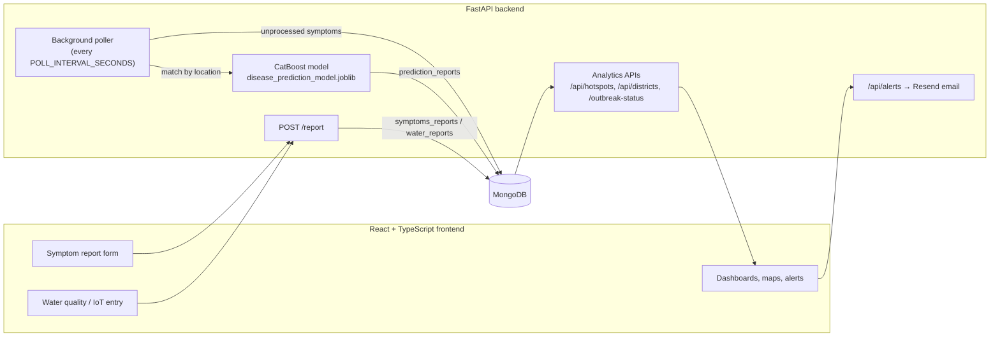

<div align="center">


# Nirogya

**Smart Health Surveillance & Early Warning System for Water-borne Diseases**

Community symptom reports + water-quality readings → machine-learning disease prediction → hotspot maps, outbreak detection and region-wide email alerts.

[](https://react.dev/)
[](https://www.typescriptlang.org/)
[](https://ant.design/)
[](https://fastapi.tiangolo.com/)
[](https://www.mongodb.com/)
[](https://catboost.ai/)

</div>

---

## Table of Contents

- [About the Project](#about-the-project)
- [Key Features](#key-features)
- [How It Works](#how-it-works)
- [Tech Stack](#tech-stack)
- [Project Structure](#project-structure)
- [Getting Started](#getting-started)
  - [Prerequisites](#prerequisites)
  - [Quick Start (Windows)](#quick-start-windows)
  - [Manual Setup (Windows, macOS, Linux)](#manual-setup-windows-macos-linux)
  - [Environment Variables](#environment-variables)
  - [Seeding Demo Users](#seeding-demo-users)
- [User Roles & Access](#user-roles--access)
- [API Reference](#api-reference)
- [Machine Learning Model](#machine-learning-model)
- [Available Scripts](#available-scripts)
- [Deployment](#deployment)
- [Troubleshooting](#troubleshooting)
- [Security Notes](#security-notes)
- [Roadmap](#roadmap)
- [Contributing](#contributing)
- [License](#license)

---

## About the Project

Water-borne diseases such as **cholera, typhoid, diarrhoea and gastroenteritis** remain a serious public-health burden in rural and tribal communities of **Northeast India** (Assam, Meghalaya and neighbouring states). Outbreaks are usually detected late because symptom data and water-quality data live in different places and reach health officials slowly.

**Nirogya** (Sanskrit/Hindi for *"free from disease"*) brings these signals together on one platform:

- **Community members and ASHA workers** report symptoms and water-source details from the field.
- **Water-quality readings** (pH, turbidity, TDS, chlorine, fluoride, nitrate, coliform, temperature) are entered manually or from IoT devices.
- A **CatBoost model** matches symptom reports with the latest water reading for the same location and predicts the likely disease.
- **Health officials** see predictions as district statistics, disease hotspots and outbreak flags, and can push **email alerts** to everyone registered in an affected region.

---

## Key Features

| Area | What it does |
| --- | --- |
| 🩺 **Symptom reporting** | Multi-step community form for patient details, symptoms, severity, duration, family members affected and water source. |
| 💧 **Water-quality monitoring** | Manual test entry and IoT device data entry (device selection + fetch), with parameter tracking and contamination status. |
| 🤖 **AI disease prediction** | Background worker merges symptom + water reports by location and runs the trained model; results are stored for analytics. |
| 🗺️ **Disease mapping & hotspots** | Leaflet maps with heat-map layers built from aggregated predictions (`/api/hotspots`). |
| 🚨 **Outbreak detection** | Flags a disease as an outbreak once predicted cases cross a threshold (`/outbreak-status`). |
| 📧 **Region-wide alerts** | ASHA workers and officials create contamination alerts (low → critical) that are emailed to users in that region via Resend. |
| 🌧️ **Rainfall alerts** | Weather forecast (OpenWeatherMap) and IMD state/district rainfall data to anticipate contamination risk. |
| 📊 **Dashboards & district stats** | Charts (Recharts / Chart.js) for trends, disease distribution, district comparison and district alerts. |
| 👩‍⚕️ **ASHA worker tools** | ASHA communication hub; admins/government users can create ASHA accounts with auto-generated credentials. |
| 🔐 **Authentication** | JWT email/password login, email OTP login, and role-based route protection. |
| 📚 **Public resources** | Education material, government reports (PDF library), news feed, gallery, emergency contacts and an FAQ-style chatbot. |
| 🌐 **Multilingual** | English and Hindi via `react-i18next`, structured to add regional languages (Assamese, Khasi, Bodo, …). |

---

## How It Works



1. A symptom report and/or water reading is posted to `POST /report` and stored in MongoDB.
2. Saving a report immediately schedules matching; a background poller also re-checks unprocessed symptom reports every few seconds.
3. Each symptom report is paired with the most recent water report for the **same location**, converted to the model's feature vector and classified.
4. Predictions are saved to `prediction_reports` and the symptom report is marked as processed.
5. Hotspot, district and outbreak endpoints aggregate those predictions for the dashboards and maps.

---

## Tech Stack

| Layer | Technologies |
| --- | --- |
| **Frontend** | React 19, TypeScript, Create React App, Ant Design 5, React Router 7, React Hook Form + Yup, TanStack Query, Axios |
| **Visualisation** | Recharts, Chart.js (`react-chartjs-2`), Leaflet + `leaflet.heat` (`react-leaflet`), Three.js, Framer Motion |
| **i18n** | i18next, react-i18next |
| **Backend** | FastAPI, Uvicorn, Pydantic, Motor (async MongoDB driver) |
| **Auth** | PyJWT, passlib + bcrypt, email OTP |
| **Email** | Resend |
| **Database** | MongoDB |
| **Machine learning** | CatBoost, scikit-learn, pandas, NumPy, joblib |
| **External data** | OpenWeatherMap, IMD rainfall API, NewsAPI, Google Maps |

---

## Project Structure

```
NIROGYA/
├── backend/                     # FastAPI application
│   ├── app.py                   # Entry point: /report, /predict, poller, outbreak status
│   ├── auth/
│   │   ├── routes.py            # /api/auth – register, login, me, admin user creation
│   │   ├── otp_routes.py        # /api/auth/otp – email OTP login
│   │   ├── alert_routes.py      # /api/alerts – create & list water alerts
│   │   ├── deps.py, models.py, utils.py
│   ├── routes/
│   │   ├── hotspots.py          # /api/hotspots
│   │   └── district_stats.py    # /api/districts
│   ├── services/
│   │   ├── mongo_client.py      # MongoDB connection & collections
│   │   ├── predictor.py         # Feature building + model inference
│   │   ├── merger.py            # Symptom + water merge → prediction
│   │   └── email_service.py     # Resend OTP / alert emails
│   ├── models/                  # Trained model served by the API
│   ├── seed_demo_users.py       # Creates demo accounts
│   ├── diagnose_model.py        # Inspects the loaded model's features
│   ├── requirements.txt
│   └── .env.example
├── nirogya-ml/                  # Model training workspace
│   ├── dataset/                 # Training data (CSV)
│   ├── models/                  # Training outputs
│   ├── train_model.py           # CatBoost training script
│   ├── preprocess.py            # One-hot preprocessing helper
│   └── requirements.txt
├── public/                      # Static assets, images, videos, government report PDFs
├── src/                         # React frontend
│   ├── api/                     # API helpers
│   ├── components/              # Layout, navbar, sidebar, maps, chatbot, alert popups
│   ├── contexts/                # Auth, alerts, language
│   ├── data/                    # Emergency contacts
│   ├── locales/                 # en.ts, hi.ts
│   ├── pages/                   # All application pages
│   ├── types/                   # Shared TypeScript types
│   └── App.tsx                  # Routes
├── start_project.ps1            # One-command setup & launch (Windows)
├── package.json
└── tsconfig.json
```

---

## Getting Started

### Prerequisites

| Tool | Version | Notes |
| --- | --- | --- |
| [Node.js](https://nodejs.org/) | 18 or newer | npm is included |
| [Python](https://www.python.org/downloads/) | **3.11** | Recommended; newer versions may lack wheels for `catboost` / pinned `bcrypt` |
| [MongoDB](https://www.mongodb.com/try/download/community) | 6.x or newer | Local install or a MongoDB Atlas connection string |
| [Git](https://git-scm.com/) | any | |

### Quick Start (Windows)

From PowerShell in the project root:

```powershell
git clone https://github.com/ashwin8332/NIROGYA.git
cd NIROGYA
.\start_project.ps1
```

The script creates `backend/venv` with Python 3.11, installs backend and frontend dependencies, copies `backend/.env.example` to `backend/.env` if it doesn't exist, and opens two terminals running the API and the React app.

> If PowerShell blocks the script, run `Set-ExecutionPolicy -Scope Process Bypass` first.

### Manual Setup (Windows, macOS, Linux)

**1. Clone the repository**

```bash
git clone https://github.com/ashwin8332/NIROGYA.git
cd NIROGYA
```

**2. Backend**

```bash
cd backend

# Create a Python 3.11 virtual environment
python3.11 -m venv venv          # Windows: py -3.11 -m venv venv

# Activate it
source venv/bin/activate         # Windows: .\venv\Scripts\activate

pip install --upgrade pip
pip install -r requirements.txt

# Create your config
cp .env.example .env             # Windows: copy .env.example .env
cd ..
```

**3. Frontend**

```bash
npm install
```

**4. Start MongoDB** (skip if you use Atlas)

```bash
mongod --dbpath /path/to/data    # or start the MongoDB service
```

**5. Run both servers** — use two terminals, both from the **project root**:

```bash
# Terminal 1 – API (must run from the project root so the `backend` package resolves)
source backend/venv/bin/activate   # Windows: .\backend\venv\Scripts\activate
uvicorn backend.app:app --reload --port 8000
```

```bash
# Terminal 2 – React app
npm start
```

| Service | URL |
| --- | --- |
| Web app | http://localhost:3000 |
| API | http://localhost:8000 |
| Interactive API docs (Swagger) | http://localhost:8000/docs |

A healthy backend start logs `Predictor: model loaded from backend/models/disease_prediction_model.joblib`, `Background poller started.` and `ML_READY = True`.

### Environment Variables

**Backend — `backend/.env`** (see `backend/.env.example`)

| Variable | Default | Description |
| --- | --- | --- |
| `MONGODB_URI` | `mongodb://localhost:27017` | MongoDB connection string |
| `MONGO_DB` | `nirogya_db` | Database name |
| `JWT_SECRET` | `change-me-to-a-long-secret` | Secret for signing JWTs — **always change this** |
| `JWT_ALGORITHM` | `HS256` | JWT signing algorithm |
| `JWT_EXPIRES_MINUTES` | `1440` | Token lifetime (minutes) |
| `POLL_INTERVAL_SECONDS` | `5` | How often the prediction poller runs |
| `RESEND_API_KEY` | *(empty)* | [Resend](https://resend.com) key for OTP/alert emails. When empty, emails are logged to the console (dev mode). |
| `MODEL_PATH` | `backend/models/disease_prediction_model.joblib` | Path to the model the API loads |

**Frontend — `.env` in the project root** (Create React App only exposes variables prefixed with `REACT_APP_`; restart `npm start` after changes)

| Variable | Default | Description |
| --- | --- | --- |
| `REACT_APP_API_URL` | `http://localhost:8000` | Backend base URL |
| `REACT_APP_NEWS_API_KEY` | — | [NewsAPI](https://newsapi.org) key for the News page |
| `REACT_APP_GOOGLE_MAPS_API_KEY` | — | Google Maps key |

Example:

```env
REACT_APP_API_URL=http://localhost:8000
REACT_APP_NEWS_API_KEY=your-newsapi-key
REACT_APP_GOOGLE_MAPS_API_KEY=your-google-maps-key
```

### Seeding Demo Users

With MongoDB running and the virtual environment active, run from the project root:

```bash
python -m backend.seed_demo_users
```

This creates one account per role, including:

| Role | Email | Password |
| --- | --- | --- |
| Admin | `admin@paanicare.com` | `admin123` |
| ASHA worker | `asha@paanicare.com` | `asha123` |
| Volunteer | `volunteer@paanicare.com` | `volunteer123` |
| Healthcare worker | `healthcare@paanicare.com` | `healthcare123` |
| District health official | `district@paanicare.com` | `district123` |
| Government body | `government@paanicare.com` | `government123` |
| Community user | `user@paanicare.com` | `user123` |

> ⚠️ These credentials are for local development only. Never seed them into a shared or production database.

---

## User Roles & Access

Public pages — **Home, Login, Register, Forgot Password, About, Contact, Map, Gallery, News, Emergency Contacts, Education** — need no login. Other pages are wrapped in role-based route guards:

| Page | Route | Allowed roles |
| --- | --- | --- |
| Dashboard | `/dashboard` | Any user |
| Community chat | `/community` | Any user |
| Report symptoms | `/report-symptoms` | Any user |
| Water quality | `/water-quality` | Any user |
| Alerts | `/alerts` | Any user |
| Rainfall alerts | `/rainfall-alert` | Any user |
| Disease mapping | `/disease-mapping` | healthcare_worker, asha_worker, district_health_official, government_body |
| ASHA communication | `/asha-communication` | healthcare_worker, asha_worker, district_health_official, government_body |
| AI prediction (water report) | `/ai-prediction` | healthcare_worker, asha_worker, district_health_official, government_body, volunteer |
| Health data | `/health` | health_worker |
| Government reports | `/goverment-reports` | district_health_official, government_body, community_user, volunteer |
| ASHA worker directory | `/asha-worker` | community_user, volunteer |
| Admin reports | `/reports` | admin *(placeholder)* |

---

## API Reference

Full, interactive documentation is generated by FastAPI at **`/docs`** (Swagger UI) and **`/redoc`**.

**Reporting & prediction**

| Method | Endpoint | Description |
| --- | --- | --- |
| `POST` | `/report` | Save a symptom report and/or water reading; triggers matching & prediction |
| `POST` | `/predict` | Predict a disease directly from water parameters + symptoms |
| `GET` | `/predictions?limit=50` | Latest stored predictions |
| `GET` | `/water_reports?limit=50` | Latest water-quality reports |
| `GET` | `/outbreak-status` | Prediction counts per disease and outbreak flag (threshold: 50) |

**Analytics**

| Method | Endpoint | Description |
| --- | --- | --- |
| `GET` | `/api/hotspots` | Hotspot buckets; query params `disease`, `district`, `days` (7), `threshold` (10), `limit` (100) |
| `GET` | `/api/districts/` | List of districts |
| `GET` | `/api/districts/stats` | Per-district statistics |
| `GET` | `/api/districts/comparison` | District comparison data |
| `GET` | `/api/districts/alerts` | District-level alerts |

**Authentication** (🔒 = requires `Authorization: Bearer <token>`)

| Method | Endpoint | Description |
| --- | --- | --- |
| `POST` | `/api/auth/register` | Register a community user |
| `POST` | `/api/auth/login` | Email/password login → JWT |
| `GET` | `/api/auth/me` 🔒 | Current user profile |
| `POST` | `/api/auth/otp/request` | Email a 6-digit login OTP (rate-limited to 1/min) |
| `POST` | `/api/auth/otp/verify` | Verify OTP → JWT |
| `POST` | `/api/auth/otp/resend` | Resend OTP |
| `POST` | `/api/auth/admin/create-asha-worker` 🔒 | Admin/government: create an ASHA worker with a temporary password |
| `POST` | `/api/auth/admin/create-government-user` 🔒 | Admin: create a government user |

**Alerts**

| Method | Endpoint | Description |
| --- | --- | --- |
| `POST` | `/api/alerts/create` 🔒 | Create a regional water alert (`low`/`medium`/`high`/`critical`) and email users in that region |
| `GET` | `/api/alerts/list` 🔒 | List alerts |
| `GET` | `/api/alerts/{alert_id}` 🔒 | Alert details |

Example prediction request:

```bash
curl -X POST http://localhost:8000/predict \
  -H "Content-Type: application/json" \
  -d '{
        "location": "Jorhat",
        "ph": 6.4, "turbidity": 18.5, "tds": 420, "chlorine": 0.1,
        "fluoride": 0.9, "nitrate": 52, "coliform": 120, "temperature": 29,
        "symptoms": ["diarrhea", "vomiting", "fever"],
        "severity": "moderate",
        "family_members_affected": 3
      }'
```

---

## Machine Learning Model

**Dataset** — `nirogya-ml/dataset/nirogya_training_dataset.csv`: 1,000 household records from four Assam districts (Cachar, Dibrugarh, Jorhat, Sonitpur).

| Label | Records |
| --- | --- |
| Diarrhea | 299 |
| Cholera | 260 |
| Gastroenteritis | 254 |
| Typhoid | 187 |

**Features**

- **Water:** pH, turbidity, TDS, chlorine, fluoride, nitrate, coliform, temperature
- **Symptoms:** diarrhea, vomiting, fever, abdominal pain, dehydration, headache (plus jaundice, fatigue, nausea in the serving pipeline)
- **Context:** district, location, primary water source (pond, river, well, tube well, municipal tap)

**Training**

```bash
cd nirogya-ml
pip install -r requirements.txt
python train_model.py
```

This trains a `CatBoostClassifier` (400 iterations, depth 6, multi-class, 80/20 stratified split), prints validation accuracy and a classification report, and writes `models/disease_prediction_model.joblib` and `models/label_encoder.joblib`.

**Serving** — the API loads the model from `MODEL_PATH` (default `backend/models/disease_prediction_model.joblib`). `backend/services/predictor.py` builds the feature vector the served model expects (one-hot districts and water sources). If you retrain and swap in a new model, make sure its feature list matches `EXPECTED_FEATURES` in `predictor.py`; `python backend/diagnose_model.py` prints the features a model file expects.

> Predictions are a decision-support signal for health workers, not a medical diagnosis.

---

## Available Scripts

| Command | Where | Description |
| --- | --- | --- |
| `npm start` | root | Run the React dev server on port 3000 |
| `npm run build` | root | Production build into `build/` |
| `npm test` | root | Run frontend tests (Jest, watch mode) |
| `uvicorn backend.app:app --reload --port 8000` | root | Run the API with hot reload |
| `python -m backend.seed_demo_users` | root | Create demo accounts |
| `python backend/diagnose_model.py` | root | Inspect the served model |
| `python train_model.py` | `nirogya-ml/` | Retrain the model |
| `.\start_project.ps1` | root | Windows one-command setup & launch |

---

## Deployment

**Frontend** — `npm run build` produces a static site in `build/` that can be hosted on Vercel, Netlify, Firebase Hosting, Azure Static Web Apps or S3 + CloudFront. Set `REACT_APP_API_URL` to your deployed API URL **at build time**, and configure SPA fallback (all routes → `index.html`).

**Backend** — run with a production server, e.g.

```bash
uvicorn backend.app:app --host 0.0.0.0 --port 8000 --workers 2
```

on Render, Railway, Azure App Service, AWS or a VM, with MongoDB Atlas as the database. Before going live:

- Set a strong `JWT_SECRET` and a real `RESEND_API_KEY`.
- Restrict CORS in `backend/app.py` (currently `allow_origins=["*"]` for development) to your frontend domain.
- Keep the model file available at `MODEL_PATH`.

---

## Troubleshooting

| Problem | Fix |
| --- | --- |
| `ModuleNotFoundError: No module named 'backend'` | Run `uvicorn backend.app:app` from the **project root**, not from inside `backend/`. |
| `ModuleNotFoundError: No module named 'jwt'` | Activate the venv and run `pip install -r backend/requirements.txt` (installs `PyJWT[crypto]`). |
| `email-validator is not installed` | `pip install email-validator "pydantic[email]"` |
| bcrypt / passlib errors on login | Keep `bcrypt==4.0.1` as pinned in `requirements.txt`. |
| `ML_READY = False` or `/predict` returns 503 | The model file wasn't found; check it exists at `MODEL_PATH`. |
| Login/register fail with network errors | Make sure the API is on port 8000 and MongoDB is running, or set `REACT_APP_API_URL`. |
| OTP/alert emails not arriving | Set `RESEND_API_KEY`; without it, emails are only printed to the backend console. |
| News page shows "No News API key provided" | Add `REACT_APP_NEWS_API_KEY` to the root `.env` and restart `npm start`. |
| Port 3000 or 8000 already in use | Stop the other process (Windows: `taskkill /F /IM node.exe` / `python.exe`; macOS/Linux: `lsof -i :8000` then `kill <pid>`), or run on another port. |
| Python version problems | Recreate the venv with Python 3.11 and reinstall requirements. |

---

## Security Notes

- **Never commit real secrets.** Keep API keys in local `.env` files and make sure `.env` is listed in `.gitignore`. If a key has ever been pushed to GitHub, rotate it with the provider — deleting it from the latest commit does not remove it from git history.
- Prefer environment variables over keys hard-coded in source files.
- Change the default `JWT_SECRET` and demo passwords before any shared deployment.

---

## Roadmap

- [ ] Live IoT sensor streaming (MQTT/HTTP) instead of manual device fetches
- [ ] Admin reports page (currently a placeholder)
- [ ] SMS / WhatsApp alerts for users without email
- [ ] Assamese, Khasi, Bodo and other regional language packs
- [ ] Offline-first PWA for low-connectivity field use
- [ ] Larger, real-world training data and model monitoring
- [ ] Docker Compose setup and CI pipeline

---

## Contributing

Contributions are welcome!

1. Fork the repository and create a branch: `git checkout -b feature/your-feature`
2. Make your changes and test the frontend (`npm test`) and backend (`/docs`) locally
3. Commit with a clear message: `git commit -m "feat: add your feature"`
4. Push and open a Pull Request describing what changed and why

Please open an [issue](https://github.com/ashwin8332/NIROGYA/issues) for bugs or feature requests.

---

## License

No license file has been added yet, so all rights are reserved by the authors by default. If you'd like to use or redistribute this code, please contact the maintainers — or add a `LICENSE` file (e.g. MIT) to make the terms explicit.

---

<div align="center">

**Nirogya** — *Safeguarding community health through technology* 💧

Built with ❤️ for the communities of Northeast India

</div>
